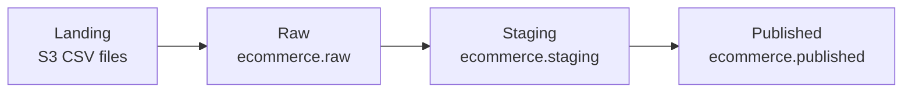

# Olist E-Commerce Analytics Pipeline

An end-to-end data pipeline on Databricks that answers business questions about revenue, customers, delivery, and reviews. It takes the Olist Brazilian e-commerce dataset (about 100,000 orders from 2016 to 2018) from raw CSV files to business-ready tables, and runs automatically as a Databricks job.

## Architecture



| This project | Medallion name |
|---|---|
| Raw | Bronze |
| Staging | Silver |
| Published | Gold |

## Tech stack

- Databricks (Unity Catalog, Delta Lake, Lakeflow Jobs)
- AWS S3 (separate buckets for landing, raw, staging, and published data)
- PySpark and SQL

## Layers

**Raw** (`ecommerce.raw`): The eight Olist CSV files (`customers`, `geolocation`, `order_items`, `orders`, `payments`, `products`, `reviews`, `sellers`) are loaded as external Delta tables. Each ingest notebook first checks that files exist in the landing folder and stops cleanly if not. The reviews notebook uses multi-line and quote-escaping options, because review comments contain line breaks and quotes that would otherwise split one review into several broken rows.

**Staging** (`ecommerce.staging`): Cleaned tables with derived columns, plus the business calculations:
- `orders`: delivery days, approval days, shipping days, a late-delivery flag, and purchase year, month, weekday, and hour
- `order_items`: total item value (price plus freight)
- `customers`: trimmed city and state
- `products`: fixed misspelled column names (`lenght` to `length`)
- `reviews`: a flag for whether the review has a comment
- `payments`, `sellers`, `geolocation`: copied as is
- Analytics tables, calculated here and published in the next layer: `customer_rfm`, `monthly_revenue`, `delivery_performance`, `review_delivery`

**Published** (`ecommerce.published`): The four analytics tables copied into the published bucket as the final business-ready tables:
- `monthly_revenue`: revenue by month, product category, and customer state
- `customer_rfm`: one row per unique customer with recency, frequency, and monetary value, scored with window functions (quintiles) into four segments (High-Value Recent, Recent Low-Spender, At-Risk High-Value, Low-Value Inactive)
- `delivery_performance`: per seller, orders delivered, average delivery and shipping time, and percentage of late orders
- `review_delivery`: average review score for late, on-time, and unknown deliveries

## Pipeline

A Lakeflow job with 24 tasks runs the whole thing: eight ingest tasks in parallel, then the staging tasks, then four analytics tasks, then four published tasks. Each task starts only when the tables it reads are ready, so independent work runs in parallel.

## Business questions answered

- How does revenue change by month, category, and state?
- Which customers are the highest value, and which high-value customers are at risk of leaving?
- Which sellers deliver late most often?
- Does late delivery lower customer review scores?

## Results

- **Customers:** 95,420 unique customers. About 3% ordered more than once, so the business depends heavily on first-time buyers.
- **Customer segments (RFM):** Low-Value Inactive 36.5%, At-Risk High-Value 23.5%, Recent Low-Spender 23.5%, High-Value Recent 16.5%. High-value customers spend about 5x more than low-value ones (about $272 vs $56). Scores are quintiles, so segment sizes follow the cut points.
- **Top categories by revenue:** health and beauty (about $1.26M), watches and gifts (about $1.21M), and bed, bath and table (about $1.04M).
- **Delivery and reviews:** About 8% of reviewed orders arrived late. Late orders average 2.57 stars versus 4.29 for on-time ones. Orders with no delivery date (cancelled or never delivered) score lowest, at 1.76.
- **Sellers:** Among sellers with 30 or more orders, the worst 10 deliver late 23% to 35% of the time, three to four times the overall rate.

## Design notes

- Customers are identified by `customer_unique_id`, because Olist assigns a new `customer_id` to every order.
- Revenue is item price, before freight, and includes all order statuses.
- Recency is measured against a fixed date (2018-10-17, near the end of the dataset) rather than today's date.
- Product category names are kept in Portuguese, as in the source data.
- The business calculations run in the staging layer, and the published layer holds the final copies.

## Roadmap

- Data quality report (null rates, orphaned keys, duplicates) as a final job task
- Named RFM segments with a frequency score
- Category-by-month revenue pivot
- UDF vs built-in RFM scoring benchmark
- Broadcast join and skew handling for seller joins
- Move the calculations into the published layer

## Repo structure

```
common/       shared helper functions and a data quality starter
ingest/       landing files to raw tables
staging/      cleaning, derived columns, analytics tables
published/    final business-ready tables
```

## How to run

1. Create the S3 buckets and Databricks external locations for landing, raw, staging, and published data.
2. Create the `ecommerce` catalog and the `raw`, `staging`, and `published` schemas.
3. Upload the Olist CSV files to the landing bucket.
4. Run the notebooks in order (ingest, staging, published), or create a Databricks job with the same order and dependencies.
